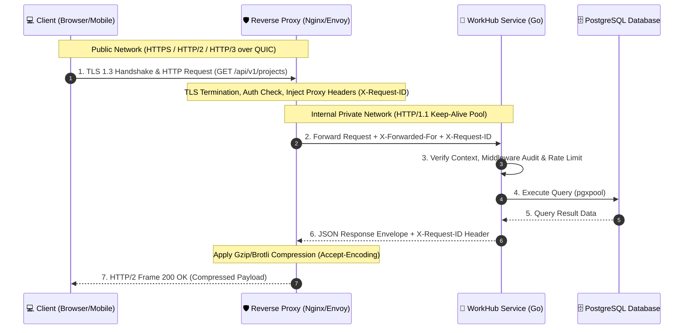

# Clinic 1 — Modern HTTP Protocols & Service Boundaries
**Document Type**: Technical Design Document, Protocol Comparison & Architectural Tradeoffs  
**Author**: Abdullah Jaber  
**Project**: WorkHub API Microservice (`workhub-service`)  

---

## 1. Executive Overview

تهدف هذه الوثيقة المعمارية إلى تحليل وتحديد بروتوكول HTTP الأنسب للعمليات داخل منصة WorkHub. تتناول الوثيقة مقارنة تفصيلية بين بروتوكولات **HTTP/1.1** و **HTTP/2** و **HTTP/3 (QUIC)**، مع وضع معايير تصميمية دقيقة لإنهاء التشفير (TLS Termination)، إدارة اتصالات البقاء (Keep-Alive)، ضغط البيانات (Compression)، حماية رؤوس الوكيل (Proxy Headers)، وإعادة استخدام الاتصالات الشبكية.

---

## 2. Protocol Comparison Matrix (جدول التحليل المقارن)

| وجه المقارنة | HTTP/1.1 | HTTP/2 | HTTP/3 (QUIC) |
| :--- | :--- | :--- | :--- |
| **بروتوكول النقل (Transport)** | TCP | TCP | UDP (عبر QUIC) |
| **نسق البيانات (Framing)** | نصي (Plaintext ASCII) | ثنائي (Binary Framing) | ثنائي (Binary Framing) |
| **تعددية الطلبات (Multiplexing)** | لا يوجد (معين لكل طلب) | ممتاز (Streams فوق TCP) | ممتاز جداً (Streams مستقلة فوق UDP) |
| **حظر رأس السلسلة (HoL Blocking)** | يقع على مستوى HTTP و TCP | يقع على مستوى TCP فقط عند فقدان الحزم | منعدم كلياً (كل Stream يتصرف بشكل مستقل) |
| **مصافحة التشفير (TLS Handshake)** | 2-RTT (أو 1-RTT مع TLS 1.3) | 2-RTT (أو 1-RTT مع TLS 1.3) | 1-RTT أو 0-RTT (TLS 1.3 مدمج كلياً) |
| **ضغط الرؤوس (Header Compression)** | لا يوجد (إرسال الرؤوس كاملة) | HPACK | QPACK (مكافيف لا تعتمد على ترتيب الحزم) |
| **إعادة الاتصال (Connection Migration)** | يتطلب إعادة إنشاء اتصال جديد | يتطلب إعادة إنشاء اتصال جديد | يدعم تنقل شبكة العميل (Connection ID) بدون انقطاع |
| **الملاءمة لـ WorkHub** | التوافقية للبنية التحتية الداخلية | كفاءة الطلبات المتعددة لـ REST API | الشبكات اللاسلكية والعملاء من تطبيقات الهاتف |

---

## 3. Real-world Use Cases & Tradeoffs (حالات الاستخدام والموازنات الهندسية)

### 🔹 حالة الاستخدام 1: واجهات برمجة التطبيقات العامة (Public REST APIs)
- **الخيار المعماري**: استخدام **HTTP/2** في الواجهة الأمامية (Edge Gateway / Reverse Proxy).
- **المبررات والتوازنات (Tradeoffs)**:
  - **المكاسب**: يستفيد المتصفح وتطبيقات العميل من فتح اتصال TCP واحد وتمرير عشرات الطلبات المتوازية (Multiplexing) للأنشطة والمهام بدون تكلفة مصافحة متكررة (Zero Handshake Latency per request).
  - **التحدي المتبادل**: في حال وجود فقدان حزم في شبكة TCP، قد تتباطأ جميع التدفقات مؤقتاً (TCP Head-of-Line Blocking).

### 🔹 حالة الاستخدام 2: الاتصال الداخلي بين الخدمات الميكروية (Internal Microservice-to-Service)
- **الخيار المعماري**: استخدام **HTTP/1.1** مع اتصالات دائمية (Keep-Alive Connection Pooling) أو **gRPC فوق HTTP/2**.
- **المبررات والتوازنات (Tradeoffs)**:
  - **المكاسب**: في الشبكات الداخلية الموثوقة (Private Subnets / VPC)، يوفر HTTP/1.1 بساطة عالية واستقراراً تاماً وسهولة في تتبع السجلات والـ Debugging عبر الوكلاء الداخليين.
  - **التحدي المتبادل**: يحتاج لضبط دقيق لحجم تجمعات الاتصالات (Connection Pool Sizing).

### 🔹 حالة الاستخدام 3: عملاء الشبكات المتنقلة والضعيفة (Mobile / Edge Clients)
- **الخيار المعماري**: تمكين **HTTP/3 (QUIC)** عند طبقة الـ Edge Gateway.
- **المبررات والتوازنات (Tradeoffs)**:
  - **المكاسب**: مرونة فائقة عند تغير شبكة العميل (مثل الانتقال من Wi-Fi إلى 4G/5G) بفضل استخدام `Connection ID` بدلاً من اعتماد الاتصال على عنوان الـ IP والـ Port، مما يمنع انقطاع جلسات التحرير أو التصفح.
  - **التحدي المتبادل**: يتطلب دعماً حزمياً لبروتوكول UDP في الجدران النارية وبنية التمرير السحابية.

---

## 4. Edge Security & Infrastructure Design (تصميم الأمان والحافة)

```text
[ Client Application ] 
       │ 
       │ HTTPS / HTTP/2 / HTTP/3 (QUIC) [TLS 1.3]
       ▼
[ Reverse Proxy / Nginx / Envoy ]  <--- TLS Termination, Rate Limiting & Compression (Gzip/Brotli)
       │ 
       │ HTTP/1.1 (Keep-Alive Pool over Private Network)
       ▼
[ WorkHub Application Service (Go) ]
```

### 🔒 1. إنهاء التشفير (TLS Termination)
- يتم إنهاء شهادة التشفير HTTPS/TLS عند طبقة الـ Reverse Proxy بدلاً من خادم التطبيق مباشرة.
- **الهدف**: توفير استهلاك الـ CPU في خادم Go وإدارة الشهادات مركزياً (مثل Let's Encrypt / Vault).

### 🛡️ 2. حماية وتوثيق رؤوس الوكيل (Proxy Headers)
تطبيق قواعد حازمة لحماية الخدمة من التلاعب بعناوين الـ IP أو البروتوكولات:
- `X-Request-ID`: معرف عالمي فريد لتتبع الطلب عبر السجلات الهيكلية (`slog`).
- `X-Forwarded-For`: يتضمن IP العميل الحقيقي، ويتم قبوله وحقنه حتمياً فقط من الوكيل الموثوق (Trusted Proxy).
- `X-Forwarded-Proto`: يثبت أن الطلب الأصلي ورد عبر بروتوكول مشفر `https`.

### ⏱️ 3. إدارة التوقيت وإعادة الاستخدام (Keep-Alive & Timeouts)
- ضبط `ReadHeaderTimeout = 5s` في خادم Go لمنع هجمات Slowloris.
- تفعيل `Cache-Control: no-store` لجميع واجهات التعديل لمنع تخزين البيانات الحساسة في ذاكرة المتصفحات الوسيطة.

---

## 5. Architectural Diagram (المخطط المعماري الرسمي)

Below is the formal architecture diagram for WorkHub Modern HTTP Protocol Handling:



---

## 6. WorkHub Implementation Decision (القرار التنفيذي للمشروع)

تمت هيكلة تطبيق `workhub-service` ليكون متوافقاً كلياً مع **HTTP/1.1 و HTTP/2** خلف Reverse Proxy، مما يوفر أداءً ممتازاً وسرعة معالجة عالية مع المحافظة على عقد واجهات الـ REST متسقاً وخالياً من التعقيدات التشغيلية غير الضرورية.
