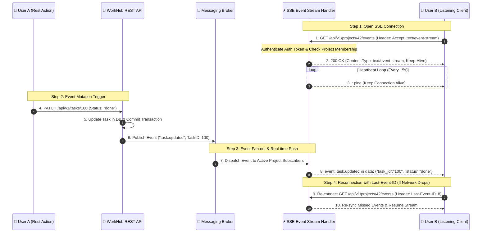

# Clinic 2 — Real-time Event Delivery & Architectural Patterns
**Document Type**: Technical Design Document, Event Delivery Patterns & Architectural Tradeoffs  
**Author**: Abdullah Jaber  
**Project**: WorkHub API Microservice (`workhub-service`)  

---

## 1. Executive Overview

تهدف هذه الوثيقة المعمارية إلى التحليل الفني الشامل وتصميم آلية التوصيل اللحظي للأحداث (Real-time Event Delivery) في منصة WorkHub. تتناول الوثيقة مقارنة تفصيلية بين الأنماط المتاحة: **Short Polling**, **Long Polling**, **Server-Sent Events (SSE)**, **WebSockets**, و **gRPC Streaming**، مع وضع الحلول المعمارية لدورة حياة الاتصال، نبضات الإبقاء (Heartbeats)، التوزيع غير الحاط (Fan-out)، الضغط العكسي (Backpressure)، وإعادة الاتصال باستخدام `Last-Event-ID`.

---

## 2. Real-time Patterns Comparison Matrix (جدول التحليل المقارن)

| وجه المقارنة | Short Polling | Long Polling | Server-Sent Events (SSE) | WebSockets | gRPC Server Streaming |
| :--- | :--- | :--- | :--- | :--- | :--- |
| **اتجاه الاتصال** | العميل يطلب تكراراً | العميل يطلب وينتظر | اتجاه واحد (Server-to-Client) | ثنائي الاتجاه (Bi-directional) | اتجاه واحد أو ثنائي |
| **البروتوكول المستعمل** | HTTP/1.1 or HTTP/2 | HTTP/1.1 or HTTP/2 | HTTP/1.1 or HTTP/2 | WebSocket Protocol (ws/wss) | HTTP/2 (gRPC Protobuf) |
| **زمن الاستجابة (Latency)** | مرتفع (مرتبط بالفاصل الزمني) | متوسط (يعتمد على الـ Timeout) | منخفض جداً (دفع لحظي) | منخفض جداً (دفع لحظي في الاتجاهين) | منخفض جداً (دفع لحظي هيكلي) |
| **استهلاك الموارد (Overhead)** | مرتفع جداً على الشبكة والسيرفر | مرتفع في فتح وإغلاق الطلبات | منخفض (اتصال persistent واحد) | منخفض جداً بعد مصافحة الترقية | منخفض جداً (تسلسل ثنائي) |
| **إعادة الاتصال التلقائي** | يدوي عبر كود العميل | يدوي عبر كود العميل | مدعوم ذاتياً في المتصفح (`EventSource`) | يستلزم كود إعادة اتصال مخصص | يستلزم كود إعادة اتصال مخصص |
| **دعم الاستئناف (Resume)** | غير مدعوم | غير مدعوم | ممتاز عبر ترويسة `Last-Event-ID` | يستلزم بناء نظام Sequence ID | يستلزم بناء نظام Sequence ID |
| **الملاءمة لـ WorkHub** | غير آمن للتوسع | استهلاك مفرط للموارد | **الخيار الأمثل للإشعارات واللوحات** | ممتاز للدردشة والتفاعل المباشر | مناسب للميكروسيرفسز الداخلية |

---

## 3. Real-world Use Cases & Tradeoffs (حالات الاستخدام والموازنات الهندسية)

### 🔹 حالة الاستخدام 1: تحديثات لوحات المشاريع وإشعارات المهام (Project Dashboard Updates)
- **الخيار المعماري المقترح**: **Server-Sent Events (SSE)**.
- **المبررات والتوازنات (Tradeoffs)**:
  - **المكاسب**:
    1. جميع التعديلات في WorkHub (تغيير حالة المهمة، إضافة تعليق) يتم إرسالها من الخادم إلى العميل فقط.
    2. يعمل فوق HTTP القياسي بدون الحاجة لترقية البروتوكول (Protocol Upgrade) أو فتح موانع نارية جديدة.
    3. المتصفح يتكفل تلقائياً بإعادة الاتصال وإرسال `Last-Event-ID` لاستعادة الأحداث الفائتة.
  - **التحدي المتبادل**: يقتصر على نقل البيانات باتجاه واحد، ولا يصلح لتطبيقات التحرير المشترك اللحظي المعقد.

### 🔹 حالة الاستخدام 2: المحادثات اللحظية ومؤشرات الحضور (Live Chat & User Presence)
- **الخيار المعماري المقترح**: **WebSockets**.
- **المبررات والتوازنات (Tradeoffs)**:
  - **المكاسب**: يوفر قنوات اتصالات مزدوجة كاملة (Full-Duplex) تعطي أداءً فائقاً في المحادثات الصوتية/النصية ومؤشرات الكتابة المباشرة ("يكتب الآن...").
  - **التحدي المتبادل**: صعوبة في إدارة الموازنات التشغيلية خلف الوكلاء (Load Balancers)، ويتطلب بناء آليات مخصصة لإدارة الـ Heartbeats والـ Reconnection.

### 🔹 حالة الاستخدام 3: تصدير التقارير الضخمة والبيانات التدريجية (Bulk Report Streaming)
- **الخيار المعماري المقترح**: **HTTP Chunked Transfer / gRPC Streaming**.
- **المبررات والتوازنات (Tradeoffs)**:
  - **المكاسب**: تدفق أجزاء البيانات فور توليدها دون الحاجة لتجميع التقرير كاملاً في الذاكرة العشوائية للخادم.
  - **التحدي المتبادل**: يرتبط بعمر طلب HTTP واحد ولا يمثل قناة أحداث دائمية مفتوحة.

---

## 4. WorkHub Real-time Delivery Architecture (بنية التوصيل اللحظي في WorkHub)

```text
[ REST API Mutation ] ──> [ WorkHub Domain Service ] ──> [ In-Memory / Redis PubSub Broker ]
                                                                     │
                                                                     ▼
[ Client EventSource ] <── [ SSE Handler (text/event-stream) ] <── [ Subscriber Channel ]
```

### 💓 1. إدارة دورة الحياة ونبضات الإبقاء (Lifecycle & Heartbeats)
- يتم التحقق من مصادقة المستخدم وعضويته في المشروع قبل فتح قناة الـ SSE.
- يرسل الخادم رسالة نبضية (Heartbeat Ping `: ping\n\n`) كل 15 ثانية لمنع المحولات والمصفيات الشبكية من إغلاق الاتصال بسبب الخمول (Idle Connection Timeout).

### 📢 2. التوزيع المحدد وتفادي الضغط العكسي (Fan-out & Bounded Backpressure)
- **التوزيع (Fan-out)**: يتم تصفية وتوجيه أحداث المشروع فقط للمستخدمين المكونين كأعضاء مقيدين في هذا المشروع (`project_id`).
- **الضغط العكسي (Backpressure)**: يتم تخصيص Bounded Buffer برقم محدد لكل مستمع (مثلاً 32 حدث). إذا كان المتلقي بطيئاً جداً وامتلأ الـ Buffer، يتم إسقاط الأحداث غير الحرجة أو إغلاق القناة لإجبار العميل على إعادة الاتصال واستجماع البيانات المحدثة عبر REST snapshot.

---

## 5. Formal Architectural Diagram (المخطط المعماري الرسمي)

Below is the complete lifecycle architecture diagram for WorkHub Real-time Event Delivery:



---

## 6. Implementation Strategy Decision (القرار التنفيذي)

تعتمد البنية المستقبلية لمنصة WorkHub نمط **SSE (Server-Sent Events)** لتحديثات اللوحات والإشعارات، مع إبقاء واجهات الـ REST لمعالجة التعديلات (Mutations). هذا الفصل المعماري يضمن أعلى أداء، خلو الاتصالات من التعقيد التشغيلي، وسهولة التوسع المستقبلي باستخدام Redis Pub/Sub بين خوادم التطبيق متعددة النسخ.
