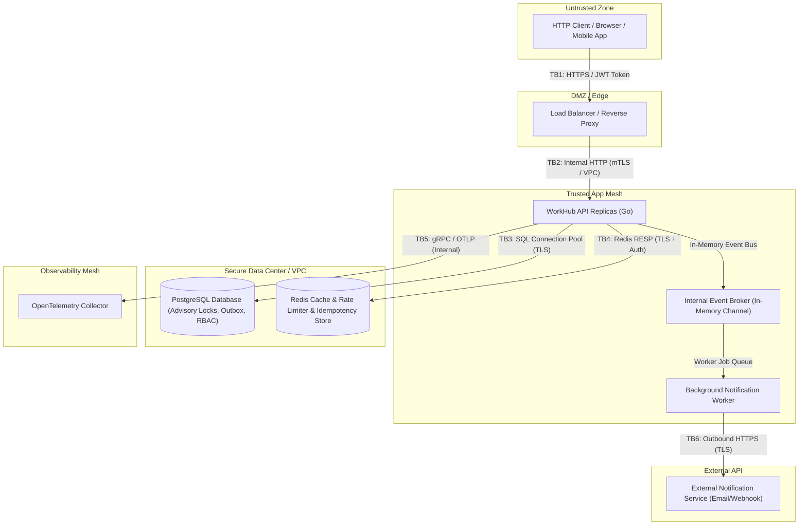

# Threat Model (STRIDE Framework) — WorkHub Service

**Document Status:** Final  
**Date:** 2026-09-17  
**Version:** v1.0.0-week1  
**Scope:** WorkHub Core Application, Authentication & Authorization Engine, Quotas, Rate Limiter, Background Workers, Persistence Layer (PostgreSQL, Redis).

---

## 1. System Overview & Architecture

WorkHub is a multi-tenant project management service written in Go, providing role-based access control (RBAC), atomic project/task quota enforcement, idempotency guarantees, rate limiting, and telemetry instrumentation.

### System Components & Trust Boundaries



---

## 2. Defined Trust Boundaries

| Boundary | Interface                      | Description                                                                        | Security Controls & Enforcement                                                                   |
| :------- | :----------------------------- | :--------------------------------------------------------------------------------- | :------------------------------------------------------------------------------------------------ |
| **TB1**  | Client → LB                    | Public ingress over untrusted internet.                                            | TLS 1.3 termination, IP-based rate limiting, WAF inspection.                                      |
| **TB2**  | LB → WorkHub Replicas          | Edge proxy forwarding traffic to Go application instances.                         | Private VPC subnets, `X-Forwarded-For` header validation, internal mTLS.                          |
| **TB3**  | WorkHub → PostgreSQL           | Application communicating with PostgreSQL database.                                | Parametrized SQL (`pgx`), TLS encrypted wire protocol, DB user least-privilege, advisory locking. |
| **TB4**  | WorkHub → Redis                | Application executing caching, rate limit scripts, and idempotency key operations. | Redis password authentication, isolated network namespace, circuit breaker fallbacks.             |
| **TB5**  | WorkHub → OTel Collector       | Telemetry pipeline exporting logs, metrics, and traces.                            | Non-blocking gRPC/HTTP OTLP exporter, sensitive data redaction filter prior to emit.              |
| **TB6**  | Worker → External Notification | Outbound notifications sent to external webhook/email provider.                    | TLS 1.3, API Key authentication, payload signing, bounded retries with dead-letter queue.         |

---

## 3. STRIDE Threat Analysis

### 3.1. Spoofing (Identity Deception)

| Asset at Risk                   | Threat                                                                                    | Mitigation in Place                                                                                                                       | Residual Risk                                                                                             |
| :------------------------------ | :---------------------------------------------------------------------------------------- | :---------------------------------------------------------------------------------------------------------------------------------------- | :-------------------------------------------------------------------------------------------------------- |
| **User Session / Access Token** | Forged JWT access token via weak signature algorithm (`alg: none` or RSA/HMAC confusion). | Enforced HMAC-SHA256 signature verification; explicit check rejecting `alg: none` or unexpected header algorithms in JWT middleware.      | Secret key exposure via configuration file compromise.                                                    |
| **User Identity**               | Stolen refresh token used to generate new access tokens.                                  | Cryptographically secure opaque refresh tokens stored hashed (SHA-256) in DB with rotation on every refresh.                              | Session hijacking during short window before token refresh occurs.                                        |
| **Authentication System**       | Refresh token replay attack using an already swapped refresh token.                       | Atomic refresh token rotation with explicit replay detection: detecting reuse immediately revokes all session family tokens for the user. | Brief concurrent window if lock is not acquired across distributed nodes (handled by Postgres row locks). |
| **Client IP Identity**          | IP spoofing via manipulated `X-Forwarded-For` header to bypass rate limits.               | Rate limiter respects configured trusted proxy count and extracts remote address securely.                                                | Misconfigured reverse proxy stripping or incorrectly setting client headers.                              |

---

### 3.2. Tampering (Data Integrity & Alteration)

| Asset at Risk                 | Threat                                                                                           | Mitigation in Place                                                                                                                                     | Residual Risk                                                                     |
| :---------------------------- | :----------------------------------------------------------------------------------------------- | :------------------------------------------------------------------------------------------------------------------------------------------------------ | :-------------------------------------------------------------------------------- |
| **PostgreSQL Database**       | SQL Injection via user input parameters.                                                         | 100% parametrized queries using `jackc/pgx/v5` prepared statements; zero raw string concatenated SQL queries.                                           | Complex dynamic query building logic bugs (if introduced in future migrations).   |
| **API Endpoints**             | Insecure Direct Object Reference (IDOR) to access/modify resources owned by other tenants/users. | Explicit RBAC permission checks (`VerifyProjectAccess`, `VerifyTaskAccess`) asserting user-tenant membership and role hierarchy before every DB action. | Logic oversights when adding new sub-resource REST endpoints.                     |
| **Filesystem / File Uploads** | Path traversal via file path inputs or file download parameters.                                 | Path sanitization using `filepath.Clean` and strict whitelist of allowed storage paths.                                                                 | Symlink traversal if custom file storage module is mounted without isolated jail. |
| **State Operations**          | Request payload duplication leading to double-charge / double-creation.                          | Redis-backed Idempotency middleware using atomic `SETNX` with lock state and cached HTTP response body replay.                                          | Redis cache eviction prior to key TTL expiry.                                     |

---

### 3.3. Repudiation (Non-Deniability & Auditability)

| Asset at Risk                        | Threat                                                                      | Mitigation in Place                                                                                                                                         | Residual Risk                                                                                                      |
| :----------------------------------- | :-------------------------------------------------------------------------- | :---------------------------------------------------------------------------------------------------------------------------------------------------------- | :----------------------------------------------------------------------------------------------------------------- |
| **Security Actions & State Changes** | Unattributed administrative actions or state changes (missing audit trail). | Database-backed atomic audit log entries inserted in the same PostgreSQL transaction as resource modifications (e.g. project creation, task status change). | Transaction rollback discards audit entry if write fails (intended behavior, but failed attempt not logged to DB). |
| **System Events**                    | Unsigned or tampered outbox notification events.                            | Outbox table entries created with unique event IDs, explicit event types, payload schemas, and timestamp tracking.                                          | Log truncation under extreme disk pressure on worker nodes.                                                        |

---

### 3.4. Information Disclosure (Data Exposure)

| Asset at Risk                             | Threat                                                                                         | Mitigation in Place                                                                                                                                                                    | Residual Risk                                                            |
| :---------------------------------------- | :--------------------------------------------------------------------------------------------- | :------------------------------------------------------------------------------------------------------------------------------------------------------------------------------------- | :----------------------------------------------------------------------- |
| **User Credentials & Secrets**            | Cleartext password or token logging in application stdout / OTel exporter.                     | Centralized JSON logger with explicit redactor masking keys (`password`, `token`, `secret`, `authorization`, `credit_card`, `email`).                                                  | Unhandled error strings wrapping raw credentials before reaching logger. |
| **Database Schema / System Architecture** | Error message leakage spilling SQL schema, table names, or internal stack traces to end users. | Global error handler envelope standardizing client-facing error responses (`code`, `message`) without internal stack details. Internal details routed exclusively to internal loggers. | Custom middleware bypassing central error responder.                     |
| **User Passwords**                        | Database compromise exposing user credentials.                                                 | Argon2id / bcrypt password hashing with unique salt per user prior to storage.                                                                                                         | Hardware side-channel attacks on password hashing routines.              |

---

### 3.5. Denial of Service (Availability & Resource Exhaustion)

| Asset at Risk               | Threat                                                                               | Mitigation in Place                                                                                                                                            | Residual Risk                                                                                                          |
| :-------------------------- | :----------------------------------------------------------------------------------- | :------------------------------------------------------------------------------------------------------------------------------------------------------------- | :--------------------------------------------------------------------------------------------------------------------- |
| **HTTP API Availability**   | Brute force or API flooding starving server resources.                               | Tiered rate limiting (sliding window/token bucket in Redis): IP level, per-user level, and endpoint-specific limits with `429 Too Many Requests` responses.    | Distributed Denial of Service (DDoS) overwhelming network bandwidth before reaching app layer (requires edge CDN/WAF). |
| **Tenant Resources**        | Tenant exhausting project/task creation to starve storage and database pool.         | Atomic PostgreSQL advisory locks enforcing strict per-tenant project, member, and task quotas.                                                                 | Large payload sizes submitted in single requests (mitigated by `PayloadSizeLimiter` middleware set to 1MB).            |
| **PostgreSQL Pool**         | Database connection starvation from heavy concurrent queries.                        | Bulkhead pattern isolating heavy database operations into bounded concurrency pools with fast-fail circuit protection.                                         | Extremely long-running analytical queries blocking connection release.                                                 |
| **Redis Cache / Service**   | Redis failure blocking application requests.                                         | 3-state Circuit Breaker wrapping Redis operations: auto-fails open for read caching (serving cache miss) and fails closed for security checks (rate limiting). | Transient spikes during circuit state transition.                                                                      |
| **Goroutine / Memory Leak** | Asynchronous worker pool buffer overflow or unbounded goroutine spawning under load. | Bounded worker pools with configurable queue capacity and backpressure rejecting over-capacity requests (`ErrQueueFull`).                                      | Context leakage if background tasks do not respect context deadlines.                                                  |

---

### 3.6. Elevation of Privilege (Access Control Violation)

| Asset at Risk                 | Threat                                                                                               | Mitigation in Place                                                                                                                                             | Residual Risk                                                   |
| :---------------------------- | :--------------------------------------------------------------------------------------------------- | :-------------------------------------------------------------------------------------------------------------------------------------------------------------- | :-------------------------------------------------------------- |
| **Project Management Rights** | Member or Viewer executing administrative actions (e.g. deleting project or removing project owner). | Strict RBAC role hierarchy (`owner > admin > member > viewer`): higher roles enforced via declarative authorization guards. Owners cannot be removed by admins. | Code refactoring breaking role check ordering in service layer. |
| **Global Quota Settings**     | Regular user modifying quota limits or overriding system defaults.                                   | Quota modification endpoints restricted exclusively to global system administrators with dedicated scope checks.                                                | Admin privilege misassignment during user provisioning.         |

---

## 4. Mitigation Matrix Summary

```
+------------------------+------------------------------------+---------------------------------------+
| Threat Category        | Primary Vector                     | Core Defense Mechanism                |
+------------------------+------------------------------------+---------------------------------------+
| Spoofing               | JWT / Refresh Token Abuse          | HMAC Validation + Replay Detection    |
| Tampering              | IDOR / SQL Injection               | RBAC Guards + Parametrized SQL        |
| Repudiation            | Operational Accountability         | Transactional Audit Logging           |
| Information Disclosure | Log PII Leakage / Error Spills     | Central Redaction + Error Envelope    |
| Denial of Service      | Resource Exhaustion / Flood        | Rate Limiter + Quotas + Worker Pools  |
| Elevation of Privilege | RBAC Hierarchy Bypass              | Hierarchical Authorization Middleware |
+------------------------+------------------------------------+---------------------------------------+
```
