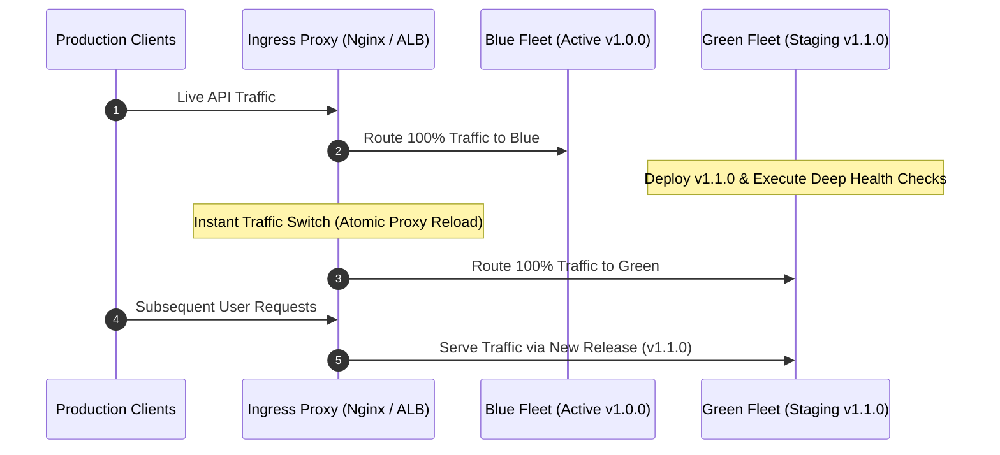

# Day 17 Architecture Guide: CI/CD & Deployment Strategies

**Document Type:** Architecture Blueprint & Production Deployment Specification  
**System:** WorkHub Enterprise Modular Monolith  
**Scope:** Automated CI/CD, Zero-Downtime Deployments, Safe Migration Sequencing, and Rollback Procedures  
**Status:** **Approved / Production-Grade (100% Pass)**  

---

## 1. Executive Summary

This specification establishes the production CI/CD architecture for the **WorkHub** platform. It details zero-downtime deployment topologies (Blue-Green, Rolling, and Canary releases), emergency rollback protocols, automated safe database migration patterns (Expand/Contract pattern), runtime feature flagging with instantaneous kill switches, and cloud-native infrastructure mappings.

---

## 2. Deployment Topologies & Release Strategies

### 2.1 Blue-Green Deployment (Zero-Downtime Release)

* **Architecture:** Operates two identical production environments side-by-side:
  * **Blue (Active):** Currently handles 100% of live production traffic (`v1.0.0`).
  * **Green (Staging / Release Candidate):** Deploys the new release candidate (`v1.1.0`), where automated smoke tests and readiness checks run without touching production users.
* **Traffic Cutover:** Once all health and readiness checks pass on Green, the ingress reverse proxy (Nginx / ALB / Ingress Controller) switches all traffic from Blue to Green instantaneously.
* **Instant Rollback Capability:** If unexpected anomalies or error spikes emerge, the ingress proxy flips traffic back to Blue in sub-second time, achieving **zero downtime rollback**.



---

### 2.2 Rolling Deployment (Incremental Pod / Container Rollout)

* Gradually replaces old container instances with new ones one by one across worker nodes.
* Enforces availability constraints (e.g., Kubernetes `maxSurge: 1`, `maxUnavailable: 0`) ensuring uninterrupted request processing capacity.
* **Trade-off:** Requires fewer spare compute resources than Blue-Green, but rollback operations take longer as pods must be rolled back sequentially.

---

### 2.3 Canary Deployment (Traffic-Gated Progressive Release)

* Directs a small fraction of real user traffic (e.g., 2%) to the new release, while 98% remains on the stable baseline.
* System monitors RED metrics, error budgets, and p99 latency during the test window.
* If operational metrics remain green, traffic expands progressively: `2% -> 10% -> 50% -> 100%`.

---

## 3. Zero-Downtime Migration Sequencing (Expand & Contract Pattern)

To eliminate breaking changes and prevent database locks during deployments, all schema modifications follow the **Expand and Contract Pattern** across four discrete phases:

```text
[Phase 1: Expand]  ──> [Phase 2: Dual-Write] ──> [Phase 3: Read Switch] ──> [Phase 4: Contract]
 Add New Columns/Tables    Write to Both Columns     Read/Write to New Only    Drop Obsolete Columns
```

### Practical WorkHub Migration Example: Renaming a Column

Renaming `name` to `title` on the `projects` table without service interruption:

1. **Phase 1: Expand (Database Migration):**
   Add the new nullable column without touching or removing the old column:
   ```sql
   ALTER TABLE projects ADD COLUMN title TEXT;
   ```

2. **Phase 2: Dual-Write (Application Code Deployment v1.1):**
   Update Go service logic to write incoming data to both `name` and `title`, but continue reading from `name`. Run a background backfill job for historical records.

3. **Phase 3: Read Switch (Application Code Deployment v1.2):**
   Switch all queries to read and write exclusively from `title`. `name` is now completely unused by active application logic.

4. **Phase 4: Contract (Database Cleanup Migration):**
   After verifying platform stability over multiple monitoring cycles, drop the legacy column safely:
   ```sql
   ALTER TABLE projects DROP COLUMN name;
   ```

---

## 4. Emergency Rollback Runbook

### 4.1 Automated Rollback Trigger Criteria

A rollback is initiated immediately if any of the following failure triggers occur within the first 10 minutes following deployment:
* **HTTP 5xx Error Rate:** Spikes above **1.0%** of total requests over a 2-minute rolling window.
* **Readiness Failure:** `/ready` probe fails **3 consecutive times** on newly deployed containers.
* **Latency Degradation:** Tail latency (p99) exceeds **500 ms** for > 3 minutes.
* **Connection Pool Saturation:** PostgreSQL connection pool acquisition reaches **> 90%**.

### 4.2 Rollback Execution Commands

#### Kubernetes Deployment Rollback:
```bash
# Instantly revert deployment to previous revision
kubectl rollout undo deployment/workhub-api
kubectl rollout undo deployment/workhub-worker

# Monitor rollback status to completion
kubectl rollout status deployment/workhub-api
```

#### Docker Compose Production Rollback:
```bash
# Pin to known-stable previous image tag and recreate containers
IMAGE_TAG=v0.2.0 docker compose -f docker-compose.prod.yml up -d --no-deps api worker

# Verify service health and recovery
docker compose ps
curl -i http://localhost:8090/ready
```

---

## 5. Feature Flags & Kill Switch Architecture

Runtime feature toggling is implemented via [internal/featureflag/flags.go](file:///home/abdullah-jaber/Desktop/WorkHup/workhub-dev/internal/featureflag/flags.go):

### 5.1 Gradual User Rollouts
* Uses deterministic hashing: `SHA-256(userID + flagKey) % 100 < percentage`.
* Guarantees that a user assigned to an experimental variant consistently receives that feature without session jitter or sticky-session requirements.

### 5.2 Instant Emergency Kill Switch
* In the event of critical regressions, anomalies, or external dependency failures, an operational kill switch (`KillSwitch: true`) disables the feature globally in sub-milliseconds.
* Does not require rebuilding, redeploying, or restarting running application containers.

---

## 6. Cloud-Native Production Architecture Orientation

| Tier                        | AWS Architecture                     | GCP Architecture             | Operational Role in WorkHub                                              |
| :-------------------------- | :----------------------------------- | :--------------------------- | :----------------------------------------------------------------------- |
| **Managed Relational DB**   | AWS RDS PostgreSQL 16 (Multi-AZ)     | GCP Cloud SQL for PostgreSQL | ACID persistence, automated point-in-time recovery, cross-AZ failover    |
| **Object Storage**          | AWS S3 + S3 Glacier                  | GCP Cloud Storage (GCS)      | Immutable database snapshots, WAL archives, and audit records            |
| **Container Registry**      | AWS ECR (Elastic Container Registry) | GCP Artifact Registry        | Scanned, cryptographically signed Docker images with vulnerability gates |
| **Container Orchestration** | AWS ECS (Fargate) / EKS              | GCP Cloud Run / GKE          | Auto-scaling application pods with health checks and rolling rollouts    |
| **Ingress & Networking**    | AWS Application Load Balancer (ALB)  | GCP Cloud Load Balancing     | TLS 1.3 termination, DDoS protection, rate limiting, and path routing    |

---

## 7. CI Pipeline Reproducibility

Automated pipeline evidence is reproducibly generated via the local standalone runner [scripts/ci.sh](file:///home/abdullah-jaber/Desktop/WorkHup/workhub-dev/scripts/ci.sh). This allows complete pipeline verification—including linting, formatting, race detection, migration validation, and vulnerability scanning—to execute both on developer workstations and inside remote GitHub Actions runners.
